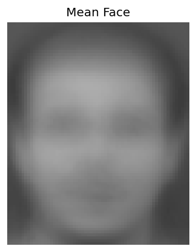
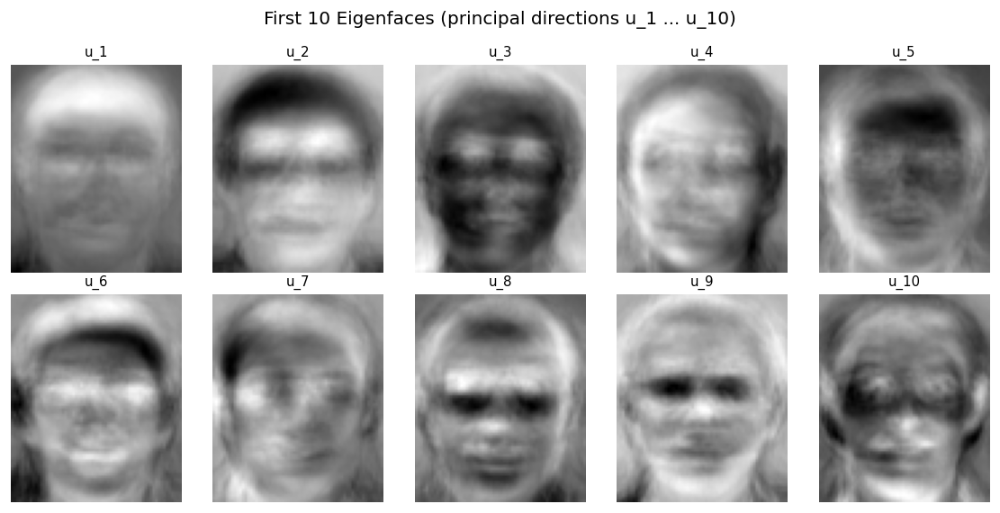
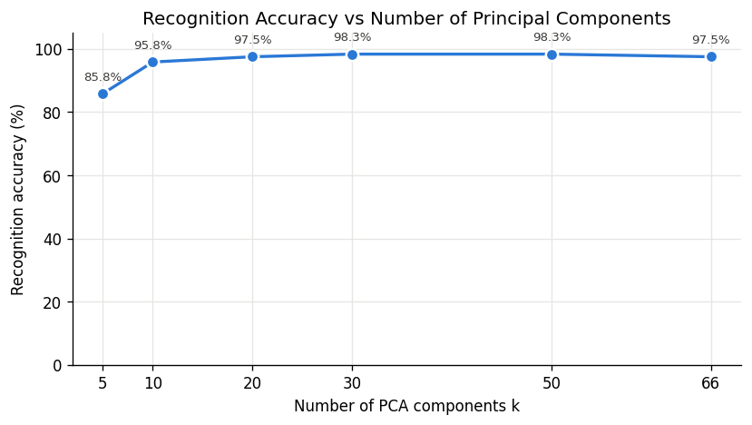
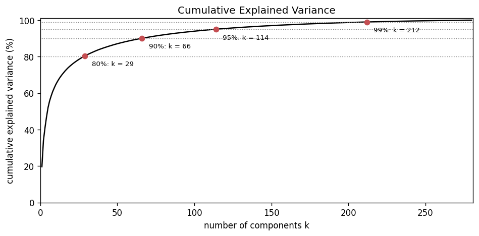

# EigenFaces: Facial Recognition Through PCA, Eigenvectors and Projection

A university mathematics mini-project. Face recognition is used as a worked example of
**vectors, matrices, mean-centering, covariance, eigenvalues, eigenvectors, orthogonality, PCA, the SVD,
projection, dimensionality reduction and Euclidean distance**.

> **Note:** this is an **educational demonstration** of the classical eigenfaces method (Turk & Pentland,
> 1991). It is **not** a modern production face-recognition system. Every mathematical step is written
> out explicitly with NumPy so it can be explained line by line.

---

## 1. What the project does

1. It turns face images into vectors.
2. It finds the directions in which faces vary most: the principal components, or **eigenfaces**.
3. It describes each face by a few coordinates along those directions.
4. It recognises a new face as the known face whose coordinates are closest.

## 2. Why PCA

A 78 × 64 grayscale image is a vector **x ∈ ℝ⁴⁹⁹²**, one coordinate per pixel. Faces do not fill this
4992-dimensional space: neighbouring pixels are strongly correlated and all faces share the same
structure. PCA finds an orthonormal basis of the directions in which faces actually vary, ordered by
variance. Keeping only the first k of them (k ≪ 4992) gives a compact description of each face. This
is dimensionality reduction by orthogonal projection.

## 3. What eigenfaces are

The principal directions u₁, u₂, … are the **eigenvectors of the covariance matrix** of the
training faces. Reshaped to 78 × 64 they look like ghostly faces, which is why they are called
eigenfaces. They are *not* photos of anyone. Each one is a unit vector, a pattern of brighter and
darker pixels relative to the mean face. u₁ is the pattern along which the training faces vary most.

## 4. Mathematical pipeline

Convention: **X ∈ ℝ^(d × N), with one face per column.**

| Step | Equation | Code (`src/`) |
|---|---|---|
| image → vector | x ∈ ℝ^d, d = 78 · 64 = 4992 | `preprocessing.preprocess_image` |
| data matrix | X = [x₁ \| … \| x_N] | `preprocessing.build_data_matrix` |
| mean face | μ = (1/N) Σ xᵢ = (1/N) X **1** | `pca.compute_mean_face` |
| centering | X_c = X − μ | `pca.center_data` |
| SVD | X_c = U Σ Vᵀ | `pca.compute_svd` (`numpy.linalg.svd`) |
| covariance and eigenvalues | C = X_cX_cᵀ/(N−1) = U[Σ²/(N−1)]Uᵀ, so C uᵢ = λᵢ uᵢ with **λᵢ = σᵢ²/(N−1)** | `pca.eigenvalues_from_singular_values` |
| explained variance | EVRᵢ = σᵢ² / Σ σⱼ² | `pca.explained_variance_ratio` |
| principal components | U_k = [u₁ \| … \| u_k], U_kᵀU_k = I | `pca.get_principal_components` |
| projection | Z_train = U_kᵀ X_c, **z = U_kᵀ(x − μ)** | `projection.project_data`, `projection.project_new_face` |
| reconstruction | x̂ = μ + U_k z | `projection.reconstruct` |
| distance | **dᵢ = ‖z − zᵢ‖₂** | `recognition.euclidean_distances` |
| identity | **ŷ = label(argminᵢ dᵢ)** | `recognition.recognize` |

C (4992 × 4992) is never formed; the SVD gives its eigenvectors directly. The full derivations are in
[`docs/mathematical_scope.md`](docs/mathematical_scope.md), and the exact file and line of every
equation is in [`docs/equation_to_code.md`](docs/equation_to_code.md).

## 5. Dataset

**AT&T Database of Faces** (formerly ORL), Olivetti Research Laboratory, Cambridge, 1992–94: 40 people × 10 images = 400 grayscale images of 92 × 112 pixels.
- It is downloaded automatically (3.8 MB, no login) from the University of Cambridge, and its SHA-256 is verified.
- It is the classic eigenfaces benchmark: small, frontal, plain background, with variation in lighting, expression and glasses.
- Please credit the Olivetti Research Laboratory.

**Preprocessing** (the same for every image, including custom photos):
1. EXIF orientation correction (phone photos) and grayscale;
2. centre crop to height : width = 78 : 64 (AT&T images, 112 : 92, already have this ratio and are not cropped);
3. resize to **78 × 64** (h × w), with the same scale factor in both directions, so faces are never stretched;
4. divide by 255;
5. flatten to x ∈ ℝ⁴⁹⁹².

There is no histogram equalisation, alignment or feature extraction.

**Split:** for each person, 3 random test images and 7 training images (seed 42).
X_train ∈ ℝ^(4992 × 280), X_test ∈ ℝ^(4992 × 120). PCA is computed from **X_train only**. Test faces are
projected with the training μ and U_k and are used for nothing else.

## 6. Results

**PCA of the 280 training faces:**
- U is 4992 × 280, and rank(X_c) = 279 = N − 1, because centering makes the columns sum to zero (σ₂₈₀ ≈ 10⁻¹³).
- The first component explains 19.6 % of the variance.
- 29 / 66 / 114 / 212 components keep 80 / 90 / 95 / 99 % of the variance.
- All identities are verified numerically to ~10⁻¹⁵: X_c = UΣVᵀ, UᵀU = I, C uᵢ = λᵢuᵢ, ΣEVR = 1, and exact reconstruction with all components.

**Recognition** (nearest neighbour in PCA space, 120 unseen test faces):

| k | variance retained | accuracy | correct / total |
|---|---|---|---|
| 5 | 52.1 % | 85.8 % | 103 / 120 |
| 10 | 64.7 % | 95.8 % | 115 / 120 |
| 20 | 75.4 % | 97.5 % | 117 / 120 |
| 30 | 80.9 % | **98.3 %** | 118 / 120 |
| 50 | 87.1 % | **98.3 %** | 118 / 120 |
| 66 | 90.1 % | 97.5 % | 117 / 120 |

- Accuracy rises quickly up to k ≈ 20 and then levels off. It is **not monotonic**, and more retained variance does not mean better recognition.
- Variance measures how well faces are *reconstructed*; accuracy measures how well people are *told apart*.
- One test face is 0.83 percentage points, so the differences above k = 20 are 1–2 faces.
- The two errors at k = 30 are s1 → s16 and s10 → s38 (`outputs/figures/confusion_matrix_k30.png`).

## Sample results

| Mean face | First 10 eigenfaces |
|---|---|
|  |  |

| Accuracy vs k | Cumulative explained variance |
|---|---|
|  |  |

## 7. How to run

Requires Python 3.10 or newer. Tested with Python 3.13.7 and both numpy 2.3.3 / matplotlib 3.10.7 /
Pillow 11.3.0 and numpy 2.5.3 / matplotlib 3.11.2 / Pillow 12.3.0.

```bash
python -m venv .venv
.venv\Scripts\activate                 # Windows   (macOS/Linux: source .venv/bin/activate)
pip install -r requirements.txt        # numpy, matplotlib, pillow, pytest - nothing else

python -m experiments.run_all          # downloads the dataset; every result and figure
python -m pytest                       # 114 tests (run after the dataset is downloaded,
                                       # otherwise 3 real-data tests are skipped)
```

Individual steps (all run from the project root):

| Command | What it does |
|---|---|
| `python -m experiments.inspect_dataset` | dataset → X (4992 × 400), checks, split, data figures |
| `python -m experiments.pca_toy_example` | PCA by hand on a 2 × 5 matrix (λ = 8, 2; u = (1, ±1)/√2) |
| `python -m experiments.run_pca` | mean face, SVD, eigenvalues, eigenfaces, variance, reconstructions |
| `python -m experiments.run_recognition` | recognition for k = 5, 10, 20, 30, 50, 66; confusion matrix; PC1–PC2 plot |
| `python -m experiments.recognize_single_face [--index i] [--k k]` | one test face, step by step (default: test face 0, which is misrecognised; `--index 4` is a correct case) |

Results go to `outputs/results/` and figures to `outputs/figures/`. The figure list is in
[`docs/presentation_assets.md`](docs/presentation_assets.md).

## 8. Custom demo (your own photos)

The demo trains the **same pipeline** on photos of a few consenting people, with one folder per person
(the folder name is the label):

```
demo_data/
├── Friend_A/  01.jpg 02.jpg ... (about 10 cropped head photos)
├── Friend_B/
├── Friend_C/
└── Friend_D/
```

```bash
python demo.py                                   # interactive menu
python demo.py train                             # PCA on demo_data/, 3 held-out photos per person
python demo.py --k 10 train                      # choose k (default 30, reduced to rank(X_c) if larger)
python demo.py --test-dir demo_test train        # separate folder of unseen test photos
python demo.py recognize path/to/new_photo.jpg   # predicted identity, nearest photo, distances
python demo.py sample                            # rehearsal data: 4 AT&T people in data/demo_sample/
```

- **Output:** the predicted identity, the nearest training photo, the Euclidean distance, and the smallest distance to each person. A distance is **not a probability**, so no confidence percentage is shown.
- **No evaluation on training photos:** the demo refuses a test photo that is byte-identical to a training photo.
- **Instructions:** cropping, photo tips and options are in [`docs/custom_demo.md`](docs/custom_demo.md).

## 9. Limitations

- **One split of one small, controlled dataset.** 98.3 % is an estimate for this split, not a general accuracy.
- **Closed set.** Every test face belongs to a known person, and an unknown person is assigned to the nearest known one.
- **Pixel-based.** Eigenfaces compare pixels directly, so they are sensitive to lighting, pose, scale and alignment. There is no face detection or alignment, so custom photos must be cropped consistently by hand.
- **Distances are not probabilities**, and they grow with k, so they cannot be compared across different k.

The full audit is in [`docs/final_project_audit.md`](docs/final_project_audit.md).

## 10. What this project deliberately does NOT use

- No neural networks, CNNs, deep learning or transformers.
- No FaceNet or other pretrained models or embeddings.
- No scikit-learn: no `sklearn.decomposition.PCA` and no classifiers.
- No OpenCV, dlib, MediaPipe, `face_recognition`, or any black-box face-recognition library.
- No cloud or LLM APIs. Everything runs locally.

The only library routine in the mathematical core is `numpy.linalg.svd`.

## Project structure

```
eigenfaces-pca/
├── README.md, requirements.txt, .gitignore
├── demo.py                      custom demo (CLI and menu)
├── src/
│   ├── data_loader.py           download (SHA-256 checked), file discovery, X + labels, split
│   ├── preprocessing.py         grayscale, resize 78 x 64, /255, flatten, build/verify X
│   ├── pca.py                   mean, centering, SVD, eigenvalues, explained variance, k, rank
│   ├── projection.py            projection (training and new faces), reconstruction, errors
│   ├── recognition.py           distances, nearest neighbour, accuracy, confusion matrix
│   ├── custom_demo.py           custom dataset: split, training, saving, recognition
│   └── visualization.py         all figures
├── experiments/                 run_all, inspect_dataset, pca_toy_example, run_pca,
│                                run_recognition, recognize_single_face
├── tests/                       114 tests (setup, data, PCA, recognition, custom demo)
├── docs/                        mathematical_scope, equation_to_code, final_project_audit,
│                                custom_demo, presentation_assets
├── data/raw/                    AT&T dataset (downloaded, not committed)
├── demo_data/                   your photos (not committed)
├── mystery/                     unseen test photos (not committed)
└── outputs/                     results/, figures/ (committed), demo/ (not committed)
```

## Author

Harshith U Shetty, BTech CSE (AI/ML), PES University, Bangalore. University mathematics mini-project.

## Acknowledgements

AT&T Database of Faces, Olivetti Research Laboratory, Cambridge. Method: M. Turk and A. Pentland, *Eigenfaces for Recognition*, 1991.
